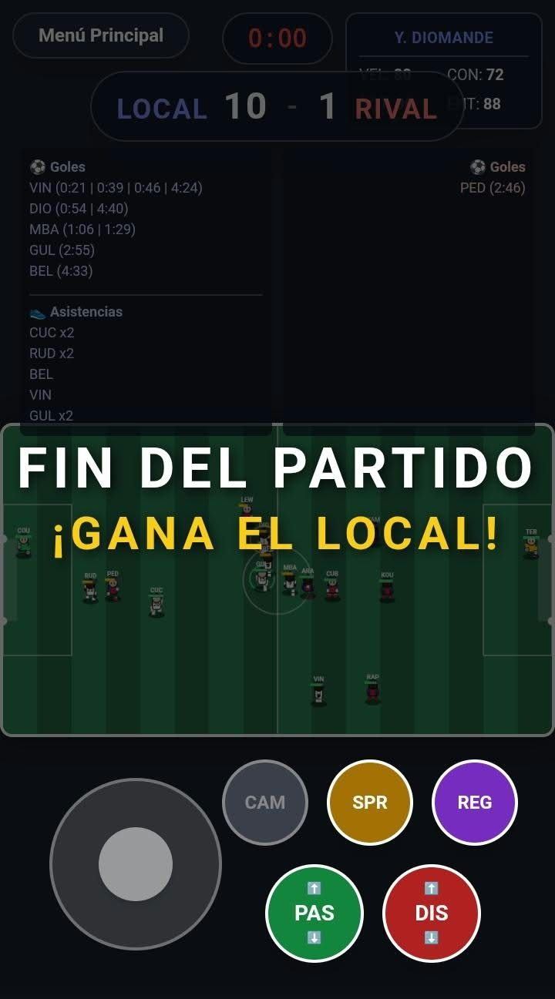

# Champions League: Dreams
A small 2D arcade football game prototype built with **HTML, CSS, JavaScript, and HTML5 Canvas**.



A 2D arcade football game prototype featuring team selection,
tactical formations, player attributes, AI opponents,
and keyboard and touch controls.

Choose your team, build a lineup, adjust player roles, and take on an AI-controlled opponent in a fast-paced match. The project started as a personal experiment and is shared as a playable prototype.

## Features

- **Team selection:** Play as Real Madrid, FC Barcelona, Paris Saint-Germain, Bayern Munich, or Manchester City.
- **Custom lineups:** Select the players for your team before each match.
- **Tactical roles:** Review and adjust player positions and roles before kickoff.
- **Multiple match modes:** Play 3v3, 5v5, 7v7, or use the 1v0 test mode.
- **Player attributes:** Players have individual stats that influence their performance.
- **Arcade football mechanics:** Passing, shooting, dribbling, tackling, sprinting, jumping, and curved shots.
- **Match feedback:** Keep track of the score, match timer, goals, and assists.
- **Keyboard and touch controls:** Play on desktop with a keyboard or use the on-screen controls on touch devices.

## Getting Started

This is a browser-based project and does not require a build step.

1. Clone the repository:

   ```bash
   git clone https://github.com/YOUR_USERNAME/champions-league-dreams.git
   ```

2. Open the project folder.
3. Open `index.html` in a modern web browser.

> The project loads Tailwind CSS from its CDN, so an internet connection is required for the utility styles to load.

## Controls

### Keyboard

| Key | Action |
| --- | --- |
| `W` `A` `S` `D` | Move |
| `Shift` | Sprint |
| `L` | Dribble |
| `J` | Pass / defensive shoulder action |
| `K` | Shoot / defensive tackle |
| Arrow keys + `J` or `K` | Perform directional special actions |
| `Space` | Switch controlled player |

### Touch devices

Touch devices display an on-screen control layout:

- Virtual joystick for movement.
- Sprint and dribble buttons.
- Player-switch button.
- Pass and shoot/action buttons, with swipe gestures for directional actions.

## Tech Stack

- **HTML5** — page structure.
- **CSS** — layout and presentation.
- **Tailwind CSS CDN** — utility styling.
- **Vanilla JavaScript** — game logic and interactions.
- **HTML5 Canvas** — pitch, players, ball, and match rendering.

## Project Status

This repository contains an experimental prototype. Gameplay, balancing, compatibility, and code organization may change as the project evolves. Some mechanics and player ratings are simplified for the purposes of the prototype.

## Running Locally

No dependencies need to be installed. You can open `index.html` directly in your browser.

For a local development server, you can also use the VS Code **Live Server** extension or another static HTTP server.

## Disclaimer

This is an independent, non-commercial fan-made project created for learning and experimentation. It is not affiliated with, endorsed by, or connected to UEFA or any of the football clubs mentioned. Club names, player names, and related trademarks belong to their respective owners.

## License

No license has been specified yet. Unless a license is added to this repository, the default copyright rules apply and reuse, modification, and redistribution are not automatically permitted.
